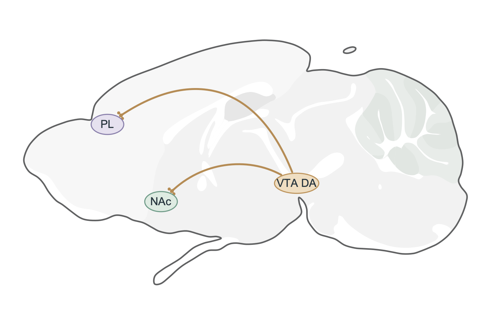

<div align="center">

# Brainmap Skill

**图谱定位 · 统一风格 · 可编辑 SVG**<br>
**Atlas-grounded · Consistent styling · Editable SVG**

[中文](#中文) · [English](#english) · [Skill](SKILL.md) · [AI contract](AI_USAGE.md)

</div>



VTA DA → NAc / PL。[SVG](examples/vta-da-circuit.svg) · [PDF](examples/vta-da-circuit.pdf) · [来源与范围 / Evidence](examples/vta-da-circuit.notes.md)

## 中文

用于成年小鼠脑区及回路示意图，不依赖特定 AI 厂商。默认只显示脑片、必要脑区标签及指定连接；脑片边界使用统一线宽，小脑依据真实分叶与白质路径表达。来源、坐标和核验记录另存。

### 安装

需要 Python 3.10+、`curl`；原生板片绘制及 PNG/PDF 导出还需要系统 Cairo 运行库。进入项目目录后：

```sh
python -m venv .venv
# macOS/Linux: source .venv/bin/activate
# Windows PowerShell: .venv\Scripts\Activate.ps1
python -m pip install '.[preview]'
brainmap fetch
```

### 绘图

优先使用 `brainmap-library`。已附 13 张原生板片、4 张三维重建底图和 287 条板片索引；索引不表示全部已下载。

```sh
brainmap-library choose --plane sagittal --regions VTA ACB PL
brainmap-library illustrate references/example-vta-da.json --out outputs/vta
brainmap-preview outputs/vta/figure.svg --png outputs/vta/figure.png --pdf outputs/vta/figure.pdf
```

优先选择 `all_targets_delineated: true`。更多板片使用 `brainmap-library fetch`；水平面、斜切面、指定 CCF 层面或投影需求再使用 `brainmap-illustrate`。`brainmap render` 是空间 QA 工具。

任何能执行 Python/终端命令的 AI 宿主均可按 [AI_USAGE.md](AI_USAGE.md) 调用。纯聊天模型可准备 JSON，实际文件仍需执行环境。

## English

Adult mouse brain region and circuit diagrams, independent of AI vendors. Final artwork contains only the brain, necessary labels and requested connections. Brain outlines have uniform weight; cerebellar texture follows source lobules and white-matter paths. Provenance and spatial audits are stored separately.

### Install

Python 3.10+, `curl`, and a system Cairo runtime for native plate rendering and PNG/PDF export are required. From the project directory:

```sh
python -m venv .venv
# macOS/Linux: source .venv/bin/activate
# Windows PowerShell: .venv\Scripts\Activate.ps1
python -m pip install '.[preview]'
brainmap fetch
```

### Draw

Use `brainmap-library` first. The package includes 13 native plates, 4 volumetric reconstruction bases and an index of 287 plates; indexed records are not all downloaded.

```sh
brainmap-library choose --plane sagittal --regions VTA ACB PL
brainmap-library illustrate references/example-vta-da.json --out outputs/vta
brainmap-preview outputs/vta/figure.svg --png outputs/vta/figure.png --pdf outputs/vta/figure.pdf
```

Prefer `all_targets_delineated: true`. Retrieve additional plates with `brainmap-library fetch`. Use `brainmap-illustrate` when horizontal/oblique, explicit CCF or projection views are needed. `brainmap render` is a spatial QA tool.

Any Python-capable AI host can follow [AI_USAGE.md](AI_USAGE.md). Chat-only models can prepare JSON requests; file generation requires an execution environment.

## 说明 / Notes

- 原生板片像素、CCF 和 Bregma 是不同空间；未经验证不转换。 / Native plate pixels, CCF and Bregma are distinct spaces; no unverified conversion.
- 缺失脑区不补画；POA 等广义区域需明确组成。 / Missing anatomy is not invented; broad regions such as POA require explicit definitions.
- 尖头表示指定激活，T 杠表示抑制，圆形末梢表示未赋予作用符号的投射。 / Triangles indicate specified activation, bars inhibition, and rounded boutons projections without an assigned functional sign.
- VTA DA 是群体示意，定位基于 VTA；PL 是 mPFC 的一部分。 / VTA DA is a population glyph anchored to VTA; PL is a component of mPFC.
- 不用于个体手术靶向。 / Not for individual surgical targeting.

[图库与来源 / Library](references/section-library.md) · [坐标 / Coordinates](references/atlas-and-coordinates.md) · [输入 / Requests](references/request-format.md) · [设计 / Design](references/illustration-design.md) · [素材署名与条款 / Attribution](THIRD_PARTY_NOTICES.md)
